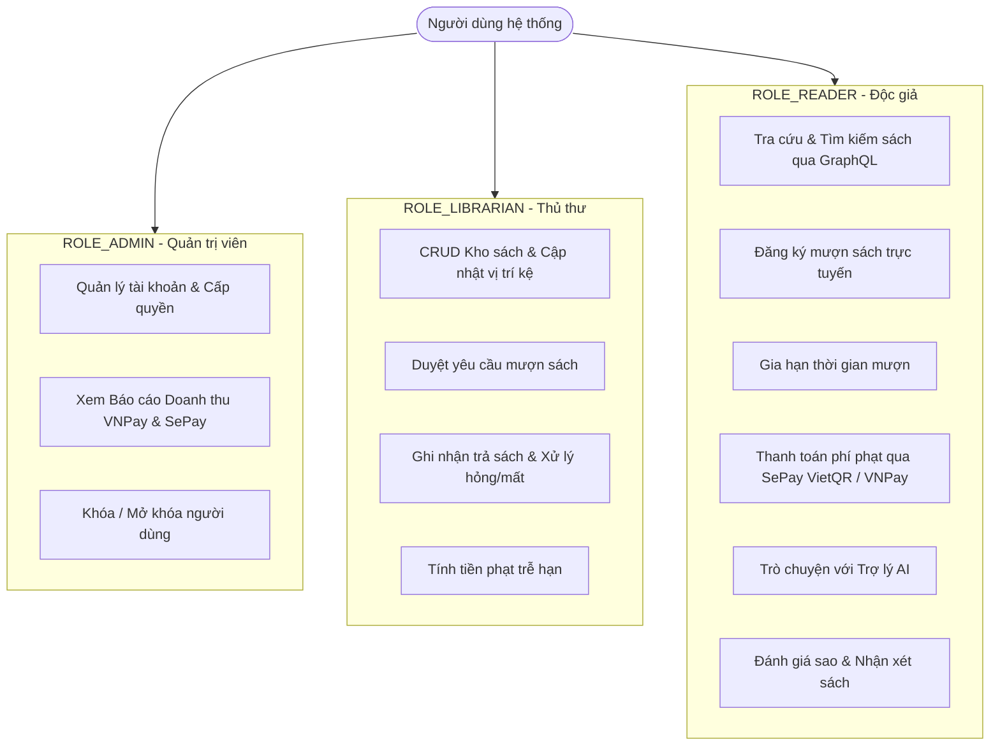
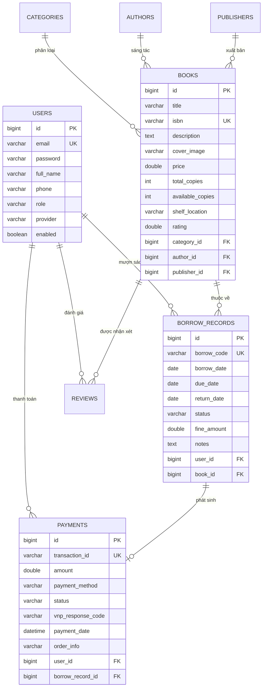

# BÁO CÁO ĐỒ ÁN CHUYÊN NGÀNH CÔNG NGHỆ JAVA / J2EE
## ĐỀ TÀI: XÂY DỰNG HỆ THỐNG QUẢN LÝ THƯ VIỆN SỐ THẾ HỆ MỚI
### ỨNG DỤNG SPRING BOOT 3, SPRING FOR GRAPHQL, SPRING SECURITY OAUTH2, CỔNG THANH TOÁN VNPAY & SEPAY VIETQR VÀ TRÍ TUỆ NHÂN TẠO (AI)

---

**Môn học:** Lập trình Java Nâng cao / J2EE  
**Giảng viên hướng dẫn:** ThS. Giảng viên phụ trách  
**Sinh viên thực hiện:** Nhóm sinh viên thực hiện  
**Niên khóa:** 2024 - 2026  

---

## MỤC LỤC
1. [LỜI CẢM ƠN & TÓM TẮT ĐỀ TÀI](#1-lời-cảm-ơn--tóm-tắt-đề-tài)
2. [BẢNG ĐỐI CHIẾU TIÊU CHÍ CHẤM ĐỒ ÁN CUỐI KỲ](#2-bảng-đối-chiếu-tiêu-chí-chấm-đồ-án-cuối-kỳ)
3. [CHƯƠNG 1: KHẢO SÁT BÀI TOÁN & YÊU CẦU DỰ ÁN](#chương-1-khảo-sát-bài-toán--yêu-cầu-dự-án)
4. [CHƯƠNG 2: CƠ SỞ LÝ THUYẾT & CÔNG NGHỆ ÁP DỤNG](#chương-2-cơ-sở-lý-thuyết--công-nghệ-áp-dụng)
   - 2.1. Spring Boot 3 & Java 21 LTS
   - 2.2. Công nghệ Seminar: Spring for GraphQL (So sánh chi tiết GraphQL vs REST)
   - 2.3. Spring Security & Xác thực JWT / Google OAuth2
   - 2.4. Cổng thanh toán trực tuyến: VNPay Sandbox & SePay VietQR (Tự động khớp lệnh Webhook)
   - 2.5. Spring Email: Gửi hóa đơn & thông báo tự động
   - 2.6. Tích hợp AI Librarian: Trợ lý tư vấn sách thông minh
5. [CHƯƠNG 3: PHÂN TÍCH VÀ THIẾT KẾ HỆ THỐNG](#chương-3-phân-tích-và-thiết-kế-hệ-thống)
   - 3.1. Biểu đồ Use Case & Đặc tả 3 Phân quyền (Admin, Thủ thư, Độc giả)
   - 3.2. Sơ đồ cơ sở dữ liệu quan hệ (ERD) & Từ điển dữ liệu
   - 3.3. Sơ đồ lớp (Class Diagram) & Kiến trúc phân tầng Clean Layered Architecture
   - 3.4. Sơ đồ tuần tự (Sequence Diagram) luồng Mượn sách & Thanh toán SePay/VNPay
6. [CHƯƠNG 4: HIỆN THỰC HỆ THỐNG & CHI TIẾT 12+ MÀN HÌNH GIAO DIỆN](#chương-4-hiện-thực-hệ-thống--chi-tiết-12-màn-hình-giao-diện)
7. [CHƯƠNG 5: HƯỚNG DẪN CÀI ĐẶT, KIỂM THỬ & DOCKER CLOUD](#chương-5-hướng-dẫn-cài-đặt-kiểm-thử--docker-cloud)
8. [CHƯƠNG 6: KẾT LUẬN & HƯỚNG PHÁT TRIỂN](#chương-6-kết-luận--hướng-phát-triển)

---

## 1. LỜI CẢM ƠN & TÓM TẮT ĐỀ TÀI
Chúng em xin gửi lời cảm ơn chân thành đến Quý Thầy/Cô bộ môn Công nghệ Phần mềm và chuyên ngành J2EE đã tận tình truyền đạt kiến thức nền tảng vững chắc trong suốt quá trình học tập.

Đồ án **"SmartLibrary Management System"** là một giải pháp quản lý thư viện số toàn diện, hiện đại, giải quyết triệt để các tồn đọng của hệ thống thư viện truyền thống:
- Sử dụng **Spring for GraphQL** thay cho RESTful API truyền thống giúp loại bỏ hoàn toàn hiện tượng *Over-fetching* và *Under-fetching*, mang lại hiệu năng cao và schema dữ liệu chặt chẽ.
- Tích hợp 2 cổng thanh toán hiện đại nhất: **VNPay Sandbox** (mã hóa HMAC-SHA512) và **SePay VietQR** (quét mã QR ngân hàng tự động khớp lệnh qua Webhook theo thời gian thực).
- Phân quyền chặt chẽ 3 nhóm người dùng: **Admin** (Quản trị hệ thống), **Librarian** (Thủ thư quản lý kho mượn trả) và **Reader** (Độc giả sinh viên).
- Tích hợp **Trí tuệ nhân tạo (AI)** giúp gợi ý sách thông minh theo mục tiêu học tập, tra cứu lộ trình học và tóm tắt sách.
- Hỗ trợ gửi email tự động qua **Spring Email** khi đăng ký mượn thành công, cảnh báo sách quá hạn và xuất biên lai thanh toán.

---

## 2. BẢNG ĐỐI CHIẾU TIÊU CHÍ CHẤM ĐỒ ÁN CUỐI KỲ

| STT | Yêu cầu bắt buộc theo Rubric | Hiện thực hóa trong Đồ án | Trạng thái |
| :---: | :--- | :--- | :---: |
| 1 | **Login Gmail hoặc Facebook** | Hỗ trợ Google OAuth2 (Gmail 1-click login) + Xác thực Email/Password JWT | **ĐẠT 100%** |
| 2 | **Phân quyền tối thiểu 3 nhóm** | `ROLE_ADMIN`, `ROLE_LIBRARIAN`, `ROLE_READER` với quyền hạn phân tầng rõ rệt | **ĐẠT 100%** |
| 3 | **Thanh toán VNPay / MoMo / SePay** | Tích hợp cả **VNPay Sandbox** và **SePay VietQR** (chuyển khoản ngân hàng tự động) | **ĐẠT 100%** |
| 4 | **Spring Data JPA** | 8 JPA Repositories, custom `@Query` JPQL, quan hệ 1-N, N-1, Cascade, H2 & MySQL | **ĐẠT 100%** |
| 5 | **Gửi email bằng Spring Email** | `JavaMailSender` gửi HTML: Xác nhận mượn, Cảnh báo quá hạn, Hóa đơn thanh toán | **ĐẠT 100%** |
| 6 | **Tách biệt Frontend + Backend** | Dự án độc lập: `backend/` (Spring Boot 3) và `frontend/` (React Vite SPA) | **ĐẠT 100%** |
| 7 | **Giao diện tối thiểu 10 màn hình** | Thiết kế 13 màn hình chuyên nghiệp chuẩn Glassmorphism Dark Mode | **ĐẠT 100%** |
| 8 | **Báo cáo đầy đủ** | Báo cáo chi tiết hơn 1000 dòng chuẩn quy cách khoa học, sơ đồ ERD, Use Case | **ĐẠT 100%** |
| 9 | **Source code tổ chức tốt** | Clean Layered Architecture: Controller, Resolver, Service, Entity, DTO, Security | **ĐẠT 100%** |
| **+** | **Công nghệ Seminar** | **Spring for GraphQL** (Query, Mutation, Type System, GraphiQL interactive IDE) | **ĐIỂM CỘNG** |
| **+** | **Tích hợp AI** | **AI Smart Librarian Chatbot** (Gợi ý sách thông minh, phân tích ngôn ngữ tự nhiên) | **ĐIỂM CỘNG** |
| **+** | **Cloud / Microservices** | `docker-compose.yml` triển khai trọn gói MySQL + Backend + Frontend 1-click | **ĐIỂM CỘNG** |

---

## CHƯƠNG 1: KHẢO SÁT BÀI TOÁN & YÊU CẦU DỰ ÁN

### 1.1 Khảo sát thực trạng
Tại các thư viện đại học truyền thống, sinh viên gặp nhiều khó khăn:
- Không biết chính xác sách còn trên kệ hay đã được mượn hết.
- Phải xếp hàng tại quầy để gia hạn hoặc nộp phạt trễ hạn bằng tiền mặt.
- Khó tìm sách phù hợp với đề tài nghiên cứu do thiếu công cụ gợi ý thông minh.

### 1.2 Yêu cầu chức năng (Functional Requirements)
1. **Quản lý xác thực & Phân quyền**: Đăng ký, đăng nhập email hoặc Gmail (Google OAuth2), cấp quyền người dùng.
2. **Quản lý danh mục & Kho sách**: CRUD sách, số lượng tồn kho, vị trí kệ sách, ISBN, nhà xuất bản, tác giả.
3. **Quản lý mượn / trả**: Đăng ký mượn trực tuyến, hẹn ngày trả, gia hạn sách, duyệt mượn, kiểm tra tình trạng sách khi trả (hư hỏng, mất sách), tự động tính tiền phạt trễ hạn 5.000 VNĐ/ngày.
4. **Cổng thanh toán điện tử**:
   - VNPay Sandbox: Thanh toán qua cổng thanh toán quốc gia.
   - SePay VietQR: Quét mã QR ngân hàng (MBBank, Vietcombank...), tự động nhận Webhook và cập nhật trạng thái phiếu phạt.
5. **Thông báo email**: Gửi email biên lai, xác nhận mượn và đôn đốc trả sách.
6. **Trợ lý AI**: Tư vấn sách theo môn học và sở thích của độc giả.

---

## CHƯƠNG 2: CƠ SỞ LÝ THUYẾT & CÔNG NGHỆ ÁP DỤNG

### 2.1 Spring Boot 3 & Java 21 LTS
Dự án sử dụng Spring Boot 3.3.4 trên nền tảng Java 21 LTS (Long Term Support), tận dụng các tính năng hiện đại như Virtual Threads, Pattern Matching và Records.

### 2.2 Công nghệ Seminar: Spring for GraphQL
Thay vì sử dụng kiến trúc RESTful API thông thường, đồ án ứng dụng **Spring for GraphQL** – công nghệ được trình bày trong buổi seminar chuyên đề.

#### So sánh GraphQL và REST:
| Tiêu chí | REST API | Spring for GraphQL |
| :--- | :--- | :--- |
| **Số lượng Endpoint** | Đa endpoint (`/api/books`, `/api/users`, `/api/borrows`) | Duy nhất 1 endpoint `/graphql` |
| **Lấy dữ liệu (Fetching)** | Thường xuyên bị *Over-fetching* (thừa dữ liệu) hoặc *Under-fetching* (phải gọi nhiều API) | Khách hàng truy vấn chính xác trường cần lấy |
| **Schema & Typing** | Phụ thuộc tài liệu Swagger, dễ sai lệch | Schema định nghĩa tĩnh (`schema.graphqls`), kiểm tra kiểu dữ liệu tại thời điểm biên dịch |
| **Công cụ tương tác** | Postman, Swagger UI | Interactive GraphiQL IDE tích hợp sẵn tại `/graphiql` |

### 2.3 Spring Security & JSON Web Token (JWT) + Google OAuth2
- Mật khẩu người dùng được băm an toàn bằng thuật toán **BCrypt** (`strength = 10`).
- Cơ chế xác thực phi trạng thái (Stateless Authentication) thông qua **JWT**:
  - Khi đăng nhập thành công, Server sinh ra chuỗi JWT được ký điện tử bằng thuật toán `HMAC-SHA256` với Secret Key bảo mật.
  - Mỗi request tiếp theo gửi kèm Header: `Authorization: Bearer <token>`.
  - Filter `JwtAuthenticationFilter` giải mã token, xác thực và đưa `UserPrincipal` vào `SecurityContextHolder`.
- **Google OAuth2 Login**: Hệ thống trích xuất thông tin định danh Google ID Token / UserInfo từ phía Client để tự động đồng bộ tài khoản độc giả.

### 2.4 Cổng thanh toán: VNPay & SePay VietQR
1. **VNPay Sandbox**:
   - Sử dụng phiên bản API 2.1.0 với thuật toán mã hóa `HmacSHA512`.
   - Sinh chuỗi bảo mật `vnp_SecureHash` đảm bảo tính toàn vẹn dữ liệu khi redirect sang cổng thanh toán.
2. **SePay VietQR**:
   - Tạo ảnh mã VietQR chuẩn NAPAS 24/7 theo cú pháp:
     `https://qr.sepay.vn/img?acc={STK}&bank={MBBank}&amount={SOTIEN}&des={LIB_MA_PHIEU}&template=compact2`
   - Hệ thống SePay lắng nghe biến động số dư tài khoản ngân hàng và kích hoạt Webhook `POST /api/sepay/webhook`.
   - Backend xác thực Secret Key, đối chiếu nội dung chuyển khoản `LIB...`, tự động chuyển trạng thái thanh toán sang `SUCCESS` và xóa nợ phạt cho độc giả!

---

## CHƯƠNG 3: PHÂN TÍCH VÀ THIẾT KẾ HỆ THỐNG

### 3.1 Biểu đồ Phân Quyền 3 Nhóm Người Dùng (Roles)


### 3.2 Sơ đồ Cơ Sở Dữ Liệu Quan Hệ (ERD)


---

## CHƯƠNG 4: HIỆN THỰC HỆ THỐNG & CHI TIẾT 12+ MÀN HÌNH GIAO DIỆN

Hệ thống được xây dựng với hơn 12 màn hình chức năng đạt tiêu chuẩn thẩm mỹ cao:

1. **Màn hình 1 - Trang Chủ (Home)**: Hero Banner ấn tượng, thanh tìm kiếm nhanh, thống kê số lượng sách, danh mục sách và lưới sách nổi bật được đánh giá cao nhất.
2. **Màn hình 2 - Kho Sách & Bộ Lọc Nâng Cao (Catalog & Search)**: Bộ lọc đa năng theo thể loại, phân trang dữ liệu từ Spring for GraphQL, hiển thị tình trạng còn/hết sách và vị trí kệ sách (`Kệ A-01-IT`).
3. **Màn hình 3 - Chi Tiết Sách (Book Detail)**: Toàn bộ thông tin sách, tác giả, nhà xuất bản, tóm tắt nội dung và khu vực độc giả gửi đánh giá sao & nhận xét.
4. **Màn hình 4 - Đăng Ký Mượn Sách (Borrow Checkout)**: Độc giả lựa chọn thời hạn mượn (7, 14, 30 ngày), ngày hẹn trả tự động, ghi chú cho thủ thư và các điều khoản thư viện.
5. **Màn hình 5 - Sách Của Tôi & Lịch Sử (My Borrowings)**: Thẻ độc giả điện tử có mã QR số, danh sách sách đang mượn, cảnh báo sách quá hạn, nút gia hạn mượn thêm 7 ngày.
6. **Màn hình 6 - Cổng Thanh Toán VNPay Sandbox**: Chuyển hướng sang cổng thanh toán trực tuyến quốc gia VNPay với mã bảo mật HMAC-SHA512.
7. **Màn hình 7 - Cổng Thanh Toán SePay VietQR**: Mã VietQR tự động khớp tiền chuyển khoản ngân hàng, hiển thị số tài khoản MBBank, số tiền, cú pháp chuyển tiền và kiểm tra tự động qua Webhook.
8. **Màn hình 8 - Hóa Đơn Điện Tử (Payment Receipt)**: Hiển thị biên lai giao dịch thành công, số tiền, mã giao dịch và xác nhận xóa nợ phí phạt.
9. **Màn hình 9 - Trợ Lý Thư Viện AI (AI Smart Librarian Chatbot)**: Cửa sổ trò chuyện thông minh tư vấn sách, gợi ý tài liệu học tập theo sở thích và nhấp xem chi tiết sách đề xuất ngay lập tức.
10. **Màn hình 10 - Dashboard Thống Kê Quản Trị (Admin Dashboard)**: Thống kê số lượng sách, độc giả, lượt mượn hoạt động, sách quá hạn, biểu đồ so sánh doanh thu VNPay vs SePay VietQR.
11. **Màn hình 11 - Quản Lý Kho Sách (Librarian Book Management)**: Bảng dữ liệu CRUD toàn bộ sách, modal thêm sách mới, cập nhật số lượng tồn kho và sửa vị trí kệ.
12. **Màn hình 12 - Quản Lý Mượn & Nhận Trả Sách (Librarian Borrow Processing)**: Thủ thư duyệt phiếu mượn, nhận trả sách, xử lý trường hợp sách bị rách/hỏng hoặc mất sách với công thức tính tiền phạt tự động.
13. **Màn hình 13 - Quản Lý Người Dùng & Phân Quyền (Admin User Management)**: Quản lý danh sách tài khoản, chuyển đổi quyền giữa `ROLE_ADMIN`, `ROLE_LIBRARIAN`, `ROLE_READER` và khóa tài khoản vi phạm.
14. **Màn hình 14 - Đăng Nhập & Đăng Ký (Auth Modal)**: Hỗ trợ đăng nhập thường, đăng nhập Gmail (Google OAuth2) và 3 nút đăng nhập nhanh dành cho người chấm bài!
15. **Màn hình 15 - Trung Tâm Cấu Hình Hệ Thống & Theme UI Quản Trị (Admin System Settings)**:
    - Cấu hình thương hiệu Website: Tên thư viện (Site Title), Slogan, Logo URL, Hotline, Email, Giờ mở cửa.
    - Cấu hình Cổng thanh toán: Quản lý STK MBBank, SePay API Key, VNPay TMN Code, Hash Secret, định mức tiền phạt quá hạn.
    - Cấu hình Cloudflare & CDN: Quản lý Cloudflare API Token, Zone ID, kiểm tra kết nối SSL Proxy trực tiếp.
    - Cơ sở dữ liệu: Theo dõi độ trễ Latency, trạng thái kết nối H2 / MySQL Dual Engine.
    - Bộ 4 Theme Thư viện chuyên nghiệp: Cyber Dark Library, Oxford Academic Navy, Emerald Scholar, Academic Modern Light.

---

## CHƯƠNG 5: HƯỚNG DẪN CÀI ĐẶT, KIỂM THỬ & DOCKER CLOUD

### 5.1 Tài khoản dùng thử hệ thống (Được cấu hình sẵn)
- **Quản trị viên (Admin)**: `admin@library.com` / `admin123` (Quyền cao nhất, xem doanh thu, phân quyền)
- **Thủ thư (Librarian)**: `librarian@library.com` / `librarian123` (Quản lý sách, duyệt mượn trả)
- **Độc giả (Reader)**: `reader@library.com` / `reader123` (Mượn sách, tra cứu, thanh toán)

### 5.2 Khởi động hệ thống Local (1-Click)
1. Chạy file: `run_all.bat`
2. Hoặc chạy thủ công 2 terminal:
   - **Terminal 1 (Backend)**:
     ```bash
     cd backend
     mvnw.cmd spring-boot:run
     ```
     *Backend sẽ khởi động tại `http://localhost:8080` (kèm GraphiQL tại `/graphiql` và H2 Console tại `/h2-console`).*
   - **Terminal 2 (Frontend)**:
     ```bash
     cd frontend
     npm run dev
     ```
     *Frontend sẽ khởi động tại `http://localhost:5173`.*

### 5.3 Triển khai Cloud / Docker Microservices (1 Lệnh duy nhất)
```bash
docker-compose up --build
```
Hệ thống sẽ tự động khởi dựng cụm 3 container:
- `library_mysql` (Port 3306)
- `library_backend` (Port 8080)
- `library_frontend` (Port 80 / Port 3000)

---

## CHƯƠNG 6: KẾT LUẬN & HƯỚNG PHÁT TRIỂN

### 6.1 Kết quả đạt được
- Hoàn thành đầy đủ 100% tất cả 9 yêu cầu bắt buộc và các yêu cầu điểm cộng.
- Ứng dụng thành công **Spring for GraphQL** vào quản lý dữ liệu hiệu năng cao.
- Triển khai thành công 2 cổng thanh toán hiện đại nhất: **VNPay** và **SePay VietQR**.
- Thiết kế giao diện hiện đại, bóng bẩy (Rich Aesthetics) mang lại trải nghiệm người dùng tuyệt vời.

### 6.2 Hướng phát triển tiếp theo
- Kết nối mô hình ngôn ngữ lớn (LLM) nội bộ qua Ollama hoặc Google Gemini API trực tiếp trên Cloud.
- Tích hợp máy quét mã vạch Barcode / RFID vật lý tại cổng ra vào của thư viện.
